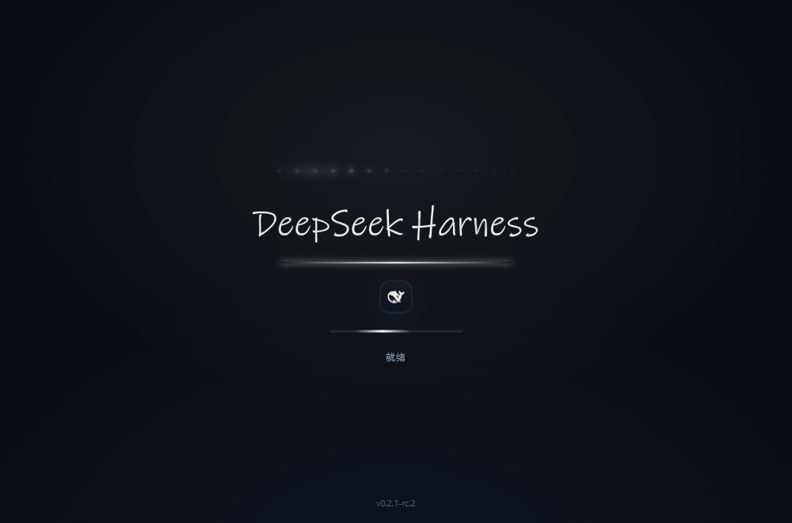
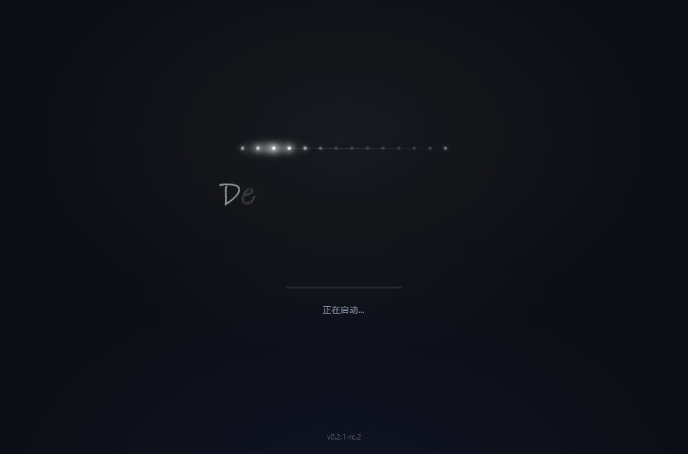

# dsh-splash

DeepSeek Harness 的启动画面：**亮白跑马灯点亮 → 一笔写出「DeepSeek Harness」→ 下划线扫过 → 鱼形 logo 淡入 → 进度条与版本号**，全程约 7 秒，播完自行淡出。

以 **DSH 插件**形态实现：不改宿主任何文件，随 DSH 升级存活，卸载即干净。

> 想要连「进程启动到主窗口出现」那段空窗期也覆盖的版本？那是改 `app.asar` 的原生补丁版，见 [`native/`](native/README.md)（两者二选一，插件默认会检测到它并让位）。




## 安装

```bash
# 从 GitHub 直接安装（推荐）
dsh plugin --profile desktop add https://github.com/www02310/dsh-go

# 从本地目录安装（开发调试）
dsh plugin --profile desktop add link:D:\path\to\dsh-go
```

装完重启 DeepSeek Harness，下次启动就会看到开场动画。

> 桌面客户端的 `desktop` profile 由 Electron 应用独占管理，命令行 `dsh plugin` 会拒绝改它。
> 这种情况按下面「手动挂载」做，一条即可。

<details>
<summary>手动挂载（desktop profile）</summary>

1. 把本仓库放到任意目录（例如 `D:\dsh-go`），在 `C:\Users\<你>\.dsh\profiles\desktop\` 下建软链接：

   ```powershell
   New-Item -ItemType Junction -Path "$env:USERPROFILE\.dsh\profiles\desktop\node_modules\dsh-splash" -Target "D:\dsh-go"
   ```

2. 编辑 `~/.dsh/profiles/desktop/package.json`：

   ```jsonc
   {
     "dependencies": { "dsh-splash": "link:D:/dsh-go" },
     "dsh": { "profile": { "bundles": [ /* …原来的… */, "dsh-splash" ] } }
   }
   ```

3. 重启 DSH。
</details>

## 配置

设置文件：`~/.dsh/splash/config.json`（首次启动后自动生成）

```jsonc
{
  "enabled": true,        // 总开关
  "oncePerSession": true, // 每个窗口只播一次（热重载/刷新不重复）
  "clickToSkip": true,    // 点击画面立即淡出
  "skipIfNative": true    // 检测到「原生补丁版」时自动让位，避免两层叠加
}
```

**图形面板**：DSH 运行后打开 `http://127.0.0.1:<端口>/dsh-splash/panel`（端口在 DSH 日志/进程里，桌面端是随机端口）。
面板里可以开关各项、预览动画、看当前状态。

也可以走路由：

| 路由 | 方法 | 说明 |
| --- | --- | --- |
| `/dsh-splash/status` | GET | 插件版本、宿主版本、配置、原生补丁检测结果 |
| `/dsh-splash/config` | POST | 改配置，body 为 `{"enabled":false}` 这样的补丁对象 |
| `/dsh-splash/panel` | GET | 图形面板 |
| `/dsh-splash/preview` | GET | 全屏预览动画（不装插件也能看效果） |

> 注入表在宿主启动时收集一次，**改完配置要重启 DSH 才生效**。写接口只接受本机（回环）请求。

## 卸载

```bash
dsh plugin --profile desktop remove dsh-splash
```

手动挂载的，删掉软链接与 `package.json` 里那两处即可。插件不写宿主文件、不驻留进程，删完即彻底消失。
想连配置一起清掉，再删 `~/.dsh/splash/`。

## 和「原生补丁版」的区别

| | 插件版（本仓库根目录） | 原生补丁版（`native/` 目录，v2.0 发布物） |
| --- | --- | --- |
| 实现 | `webServer` 的 `index-inject` 注入覆盖层 | 改 Electron 主进程 `app.asar`，开独立启动窗 |
| **从点图标到出画面** | **5–10 秒**：注入表要等宿主 boot 完成才下发，插件越多的机器越晚（本机实测 5.5 / 9.9 秒） | **约 1 秒**：主进程一起来就开窗，不等宿主 boot |
| 覆盖范围 | 主窗口内容区（窗口一显示就是动画） | 进程启动到主窗口就绪之间的完整空窗期 |
| DSH 升级 | **不受影响**，自动存活 | 升级替换 `app.asar` 后失效，需重装 |
| 安装 | 一条 `dsh plugin add` | 关闭 DSH → 跑安装脚本 |
| 卸载 | 删插件即可 | 从备份还原 `app.asar` |
| 风险 | 零文件改动 | 改动宿主二进制（有逐字节自校验与备份） |

> 想要「点图标就有画面」，用原生补丁版；只接受「打开后一秒内看到动画」、不在意开头那段空窗，插件版更省心。两者可共存，插件会自动让位。

两者默认不会同时出画面：插件检测到 `app.asar` 里有原生补丁时会自动让位（`skipIfNative`）。

## 实现要点

- 注入三件事：一条 `global` 行（`__DSH_SPLASH_META__`：版本与配置）+ 一条内联 `script` 行（覆盖层本体）。
  用**内联 script 而不是 script-src**：内联行不会加载失败，也就不可能把 `__DSH_BOOT_READY__` 卡死（那是 script-src 失败时的宿主级故障）。
- 覆盖层挂在 **closed shadow DOM** 里，宿主样式进不来、覆盖层样式也污染不到宿主。
- 动画在「窗口真正可见」时才起跑：优先等 `focus` 事件，其次等 React 挂载出 `#root` 内容，最后 4 秒兜底；
  20 秒硬保险无论如何都收掉，绝不挡界面。
- `assets/splash-overlay.js` 是从 `assets/splash.html` 生成的：改画面只改 html，然后

  ```bash
  node tools/build-overlay.mjs
  ```

## 兼容性

- 实测于 **DSH 0.2.1-rc.2（Electron 44.7.0）**。
- 依赖宿主提供 `webserver/index-inject` 注入表（并支持 `global` / `script` 行）。
  宿主不提供时插件只是静默不生效，不会影响 DSH 启动。
- `tools/harness.html` 是不依赖 DSH 的本地预览页：起个静态服务打开即可调试动画。

## License

MIT
