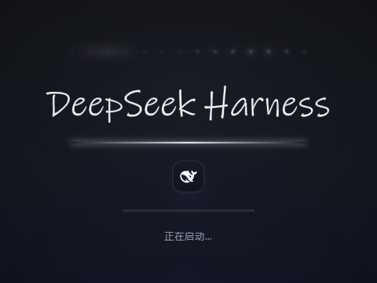
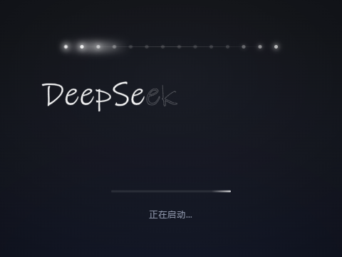

# DeepSeek Harness 启动画面

给 DSH 桌面端加一个启动画面：点图标后约 1 秒就出现（不等宿主 boot），主窗口真正显示的那一刻自动关闭。

**效果顺序**：深色底 → 一排亮白跑马灯（点阵依次点亮 + 光束扫过）→ **亮白一笔写出 DeepSeek Harness**（手写体逐字母落笔，带辉光笔尖，写完后填色）→ 下划线扫过 → 鱼形 logo 淡入 → 加载条 + 版本号。

启动窗**跟 DSH 主窗口一样大、一样位置**：宿主窗口一建出来就 `setBounds` 对齐，窗口移动/缩放也实时跟随；下次启动直接复用上次的位置尺寸（`%USERPROFILE%\.dsh\splash\window.json`），不会先大后小地跳一下。收尾用全局窗口事件：只要有一个够大的窗口真正显示出来就关掉它，绝不会留在已经就绪的主界面上。

## 安装

1. **完全退出 DSH**：右键托盘图标 →「退出」。注意关窗口只是最小化，不算退出。
2. 双击 **安装.cmd**。
3. 看到「完成」后启动 DSH 即可（脚本会问你要不要现在启动）。
4. 想撤回：退出 DSH → 双击 **卸载.cmd**。

安装过程会自动：

- 从注册表 / 常见路径定位 DSH 安装目录（找不到会提示你手动填）；
- 使用 DSH 自带的 node 运行时（不需要你装 Node.js）；
- 备份原始 `resources\app.asar` 为 `app.asar.pre-splash.bak`；
- 重建 asar 并逐字节校验其余 1.6 万个文件后再落盘（失败不做任何修改）。

## 环境要求

- Windows 10 / 11（x64）
- DeepSeek Harness 桌面版，**已在 0.2.1-rc.2（Electron 44.7.0）实测通过**
- 不需要管理员权限；但如果 DSH 装在 `C:\Program Files` 下，需要右键 安装.cmd →「以管理员身份运行」

## 兼容性与升级

- 补丁改的是 `resources\app.asar` 里的 `lib/main.js`。不同 DSH 版本代码可能不同：插入点对不上时脚本会报「插入点不存在」并**什么都不改**，DSH 不受影响。
- **DSH 自动升级会替换 app.asar，启动画面随之消失**——升级后重新运行一次 安装.cmd 即可。
- 与其它插件（如 dsh-purge）不冲突：补丁只加一段启动画面逻辑，找不到画面文件就整体跳过。

## 卸载

退出 DSH → 双击 卸载.cmd，从备份还原。想彻底清理可再删除 `%USERPROFILE%\.dsh\splash` 文件夹。

## 常见问题

| 现象 | 处理 |
|---|---|
| 弹 SmartScreen / 杀软拦截 | 脚本未签名，属正常。右键文件「属性」勾选「解除锁定」，或在杀软里给本文件夹加信任 |
| 提示「检测到 DSH 正在运行」 | 到托盘完全退出 DSH 再试 |
| 提示「没有写入权限」 | 右键 安装.cmd →「以管理员身份运行」 |
| 找不到安装目录 | 安装时会提示你粘贴路径（目录里应有 `DeepSeek Harness.exe`） |

## 文件说明

| 文件 | 用途 |
|---|---|
| `安装.cmd` / `install.ps1` | 一键安装（自动探测目录、权限自检、安装后可顺手启动 DSH） |
| `卸载.cmd` / `uninstall.ps1` | 一键还原 |
| `apply-splash.mjs` | 补丁核心（重建 asar + 自验证 + 备份/还原），也可手动：`node apply-splash.mjs [--dry-run] [--restore] [安装目录]` |
| `splash/splash.html` | 启动画面本身（自包含）。想改画面可编辑后复制到 `%USERPROFILE%\.dsh\splash\splash.html` |
| `splash/logo.svg` | 画面里的鱼形 logo |
